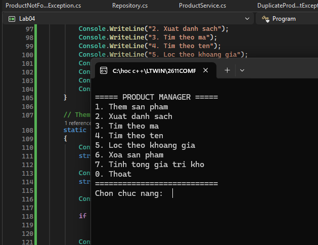
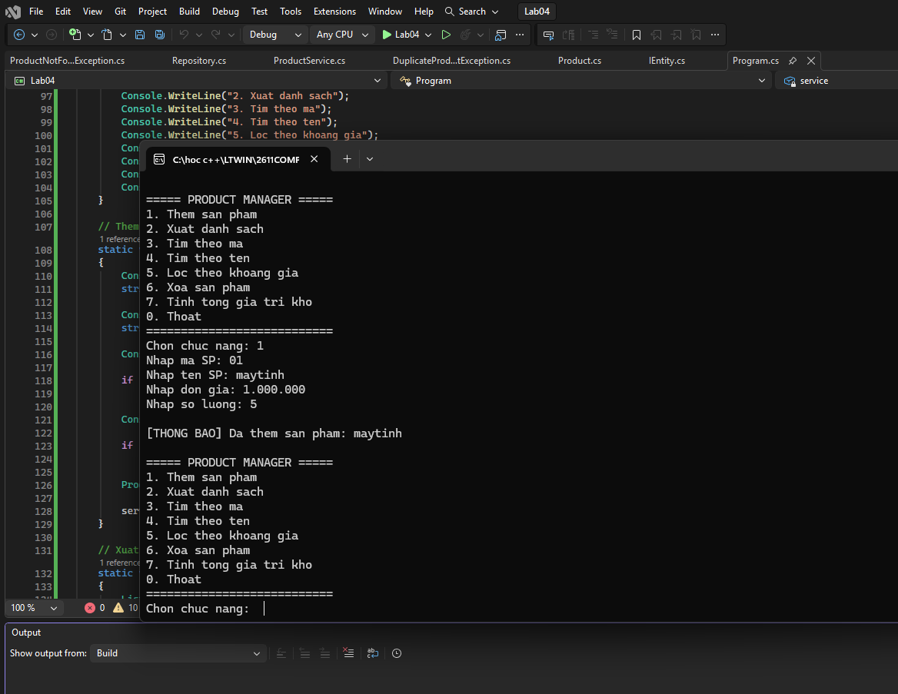

Lab04

Mo ta: Viết chương trình Console quản lý sản phẩm. Dữ liệu được lưu trong bộ nhớ bằng một Repository<T>. Chương trình 
phải xử lý lỗi nhập liệu, mã sản phẩm trùng và sản phẩm không tồn tại bằng exception phù hợp.

### hình ảnh 1: menu

### hình ảnh 2: them sinh vien & hien thi danh sach sinh vien

