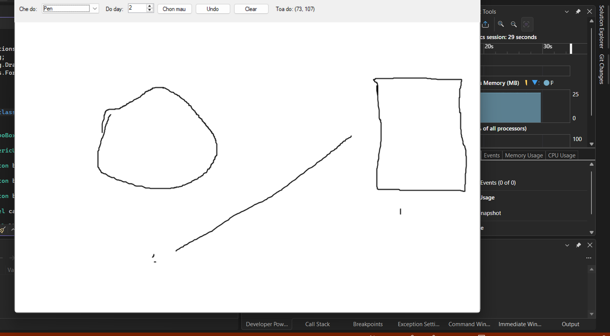

# LAB08 -- Ứng dụng Paint đơn giản bằng GDI+

## 1. Giới thiệu

Bài thực hành xây dựng ứng dụng Paint đơn giản bằng **C# Windows Forms**
và **GDI+**. Người dùng có thể chọn chế độ vẽ, màu sắc, độ dày nét vẽ và
thao tác trực tiếp trên vùng canvas bằng chuột.

Các nét vẽ được lưu trong danh sách đối tượng để có thể vẽ lại khi cửa
sổ bị che hoặc thay đổi kích thước.

### hình ảnh 1: giao diện paint

